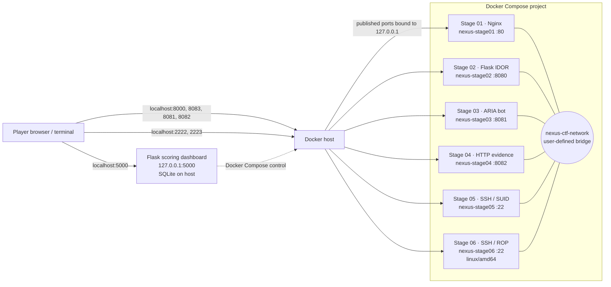

# Operation: Rogue Insider — Project Design and Deployment Report

## Project purpose

Operation: Rogue Insider is a six-stage, local cybersecurity training exercise built around a simulated Nexus Corp incident. Players move from public web reconnaissance through application security, AI prompt injection, packet analysis, Linux privilege escalation, and binary exploitation. Docker Compose runs the challenge services together; the Flask dashboard runs on the host and records submitted flags and purchased hints in SQLite.

This repository is an instructor bundle. It contains challenge answers, credentials, flags, and exploit references. Distribute a player package with those materials removed when challenge integrity matters.

## Contributors and responsibilities

| Contributor | Assignment |
|---|---|
| Manukulasuri Platform (name as supplied) | Docker Compose integration, architecture and network design, deployment plan, port mapping, container naming, bridge network, restart policies, isolation controls, and install instructions |
| S.A.G.A. Sherangi — IT24100958 | Challenge Design A, Stages 01–03: Nexus website and steganography, Nginx image, employee portal and IDOR, MD5 password hash, ARIA prompt-injection simulation, authentication gate, flags, and hints |
| L.G. Sithum Sanjana — IT24102538 | Challenge Design B, Stages 04–06: PCAP generator and HTTP file server, SUID PATH-hijacking binary and SSH service, XOR PIN and vulnerable vault, ROP reference solver, flags, and hints |
| U. Ayushyaa — IT24102996 | Integration, documentation, dashboard, validation plan and matrix, walkthrough, risk analysis, and final report |

Names and student identifiers are transcribed from the supplied assignment notes; confirm spelling and the first contributor's identifier before formal submission.

## Architecture

### Port and service map

| Stage/service | Compose service | Container name | Container port | Host binding |
|---|---|---|---:|---:|
| Stage 01 — Nexus static site | `stage01-nexus-web` | `nexus-stage01` | 80/TCP | `127.0.0.1:8000` |
| Stage 02 — employee portal | `stage02-webapp` | `nexus-stage02` | 8080/TCP | `127.0.0.1:8083` |
| Stage 03 — ARIA bot | `stage03-ai-bot` | `nexus-stage03` | 8081/TCP | `127.0.0.1:8081` |
| Stage 04 — evidence HTTP server | `stage04-pcap-server` | `nexus-stage04` | 8082/TCP | `127.0.0.1:8082` |
| Stage 05 — SSH / PATH hijacking | `stage05-ssh-server` | `nexus-stage05` | 22/TCP | `127.0.0.1:2222` |
| Stage 06 — SSH / vault ROP | `stage06-vault-server` | `nexus-stage06` | 22/TCP | `127.0.0.1:2223` |
| Scoring dashboard (host process) | Not in Compose | Host process | 5000/TCP | `127.0.0.1:5000` |

Every Compose service uses the `nexus-ctf-network` user-defined bridge and `unless-stopped` restart policy. Host port publishing is explicitly bound to loopback so the intentionally vulnerable services are not exposed on LAN interfaces by default. Stage 06 requests the `linux/amd64` platform because its challenge binary and ROP exercise target x86-64.

The shared bridge supplies a common private container network and DNS service discovery. It is not per-stage network segmentation: a compromised container can potentially reach other containers on that bridge. Keep the stack on a trusted host, avoid attaching unrelated containers to this network, and stop it after the exercise. Stronger isolation for multi-tenant or remote events requires separate networks and a deliberate access design.

## Player progression and component ownership

| Stage | Category | Challenge artifact / service | Progression output |
|---|---|---|---|
| 01 | OSINT and steganography | Nginx site and steghide image | Blueprint flag and Stage 02 lead |
| 02 | Web security and hashes | Flask employee portal with IDOR and MD5 hash | Stage 02 flag and administrator password for Stage 03 |
| 03 | AI/LLM security simulation | Authenticated Flask ARIA bot with keyword-triggered prompt-injection path | Stage 03 flag and evidence server lead |
| 04 | Network forensics | Scapy-generated PCAP served over HTTP | Stage 04 flag and Stage 05 SSH credentials |
| 05 | Linux privilege escalation | SSH account and root SUID PATH-hijacking binary | Stage 05 flag and Stage 06 SSH credentials |
| 06 | Reverse engineering and exploitation | Root-owned SUID x86-64 vault with XOR PIN and stack overflow | Final flag via a ROP chain |

The dashboard accepts flags and awards 100 points for each first successful submission. Hints are available by stage with point costs. The dashboard is a separate host process: its account needs permission to run Docker Compose because the dashboard's machine controls invoke Compose commands.

## Deployment plan

### Prerequisites

- Docker Engine and Docker Compose v2, or Docker Desktop.
- Python 3.9+ and pip for the scoring dashboard.
- An x86-64 host recommended; Docker Desktop on ARM may emulate Stage 06.
- Free ports 8000, 8081, 8082, 8083, 2222, 2223, and 5000.
- Internet access during the first image build to fetch base images and packages.

### Launch

1. Open a terminal in the project root.
2. Build and launch the six stage containers with `docker compose up -d --build`.
3. Start the dashboard in a second terminal with `./start_dashboard.sh` (Windows steps are in `INSTALL_INSTRUCTIONS.txt`).
4. Visit `http://localhost:5000`, create a player account, and open the stage targets from the dashboard.
5. Use [Official_Walkthrough.md](./Official_Walkthrough.md) only for instructor guidance.

### Operations and shutdown

- Review container state and logs with `docker compose ps` and `docker compose logs --tail=100`.
- Stop containers while retaining them with `docker compose stop`.
- Stop and remove the project containers and network with `docker compose down`.
- Rebuild after source changes with `docker compose up -d --build`.
- Dashboard progress lives in `ctf_dashboard/ctf_users.db`; back it up separately if scores must persist. Do not include the local database in a player or source release.
- The HTTP evidence server serves the PCAP generated during the Stage 04 image build. Rebuild that image after changing its generator.

## Validation plan and acceptance matrix

This section defines validation work for an operator or assessor. It records expected outcomes and is not a claim that these checks were executed.

| ID | Area | Validation action | Expected result | Evidence to record |
|---|---|---|---|---|
| V-01 | Compose configuration | Review resolved Compose configuration and service names | Six services, fixed names, loopback-only published ports, bridge network, restart policies, Stage 06 platform | `docker compose config` output |
| V-02 | Lifecycle | Start, inspect, stop, and remove the stack | All six services start; Compose stop/down operates on the project | `docker compose ps` and lifecycle command output |
| V-03 | Port exposure | Inspect host listeners and published bindings | Challenge ports listen on loopback only | `docker compose port` output and host listener listing |
| V-04 | Stage 01 | Browse the site and retrieve/extract the embedded file | Site and assets load; hidden blueprint is recoverable | Browser capture and extracted blueprint |
| V-05 | Stage 02 | Register/login, alter the profile identifier, inspect hash | IDOR exposes the intended admin record and hash | Redacted request/response capture |
| V-06 | Stage 03 | Authenticate with Stage 02 credential and submit intended prompt | Gate accepts the credential and simulation returns its stage clue | Redacted browser capture |
| V-07 | Stage 04 | Download and inspect the PCAP; reconstruct sequence | Covert ICMP chunks decode to the intended credential and flag | PCAP hash and decoded output |
| V-08 | Stage 05 | Connect over SSH and inspect/exploit the SUID diagnostic | Intended PATH hijack reaches root in the isolated container | Redacted session transcript |
| V-09 | Stage 06 | Inspect binary properties, recover PIN, run reference exploit | x86-64 ROP chain reaches the protected flag in the container | Binary metadata and redacted session transcript |
| V-10 | Dashboard | Register, submit valid/invalid/repeated flags, use hints | Scores update once per stage, invalid flags do not score, hints apply configured cost | SQLite score snapshot and UI capture |
| V-11 | Dependencies | Follow each stage's clue to the next stage | Credentials and links match the next service and walkthrough | End-to-end operator notes |
| V-12 | Reset and cleanup | Reset a test account and run Compose down | Account progress resets; containers/network are removed as intended | UI capture and Compose output |

## Risk assessment and mitigations

| Risk | Impact | Mitigation |
|---|---|---|
| Intentionally vulnerable services are reachable from an untrusted network | Host or adjacent systems could be attacked | Keep loopback bindings, use a dedicated trusted host, do not forward ports, and stop the stack after use |
| All stages share one bridge network | Compromise in one service may permit lateral access to other stages | Keep the bridge exclusive to this project; for remote or multi-tenant use, segment networks and allow only required flows |
| Dashboard can control Docker | A dashboard compromise may gain the host user's Docker-level privileges | Run only for trusted local events, use a dedicated host account, do not expose port 5000, and stop the dashboard after play |
| Instructor bundle includes flags, credentials, hashes, and exploit code | Players can bypass challenge progression | Distribute a curated player bundle; keep instructor files and source repository access restricted |
| Dashboard uses a fixed Flask session secret in source | Session forgery can undermine local score integrity | Treat scores as non-authoritative for trusted environments; for public deployment, externalize a random secret and harden the application before deployment |
| Dashboard uses its built-in development server | Limited robustness and security for concurrent/public use | Keep it local and low-concurrency; use a production WSGI server and additional hardening for any hosted event |
| Stage 05/06 use fixed credentials and vulnerable root-owned programs | Escalation is intentionally straightforward inside the lab | Never reuse the credentials; isolate containers and host; rebuild from trusted source after the event |
| First build depends on external package repositories and image tags | Build may fail or change as upstream packages move | Build before the event, retain known-good images, and pin image digests/packages for reproducible long-term delivery |
| Stage 06 architecture mismatch or address-layout change | Reference exploit may fail | Prefer x86-64; rebuild the exact image and derive gadget addresses from its binary; record the image revision used |

## Completion and handoff

The repository includes the six stage source trees and Dockerfiles, Compose orchestration, a host-run interactive scoring dashboard, installation instructions, and the official walkthrough. The validation matrix above is a planned assessment checklist; attach execution evidence after a separate validation session. For a formal submission, include the final repository revision and the requested report in the course's preferred format.
